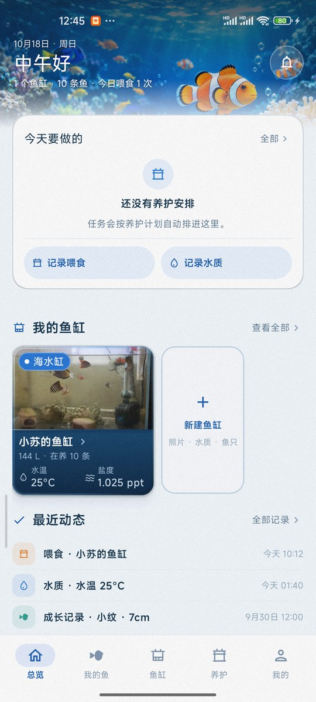
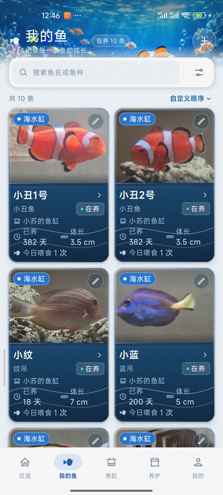
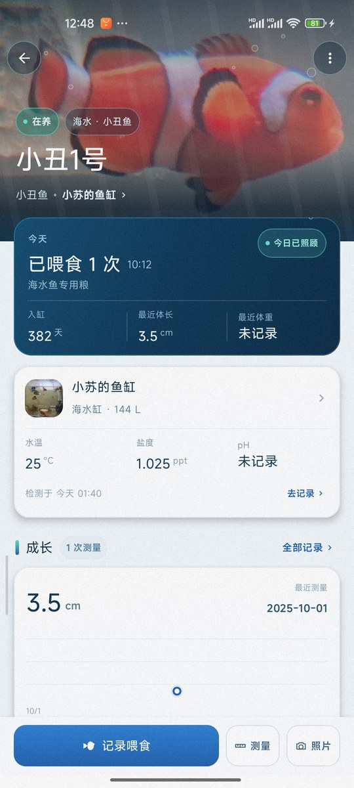
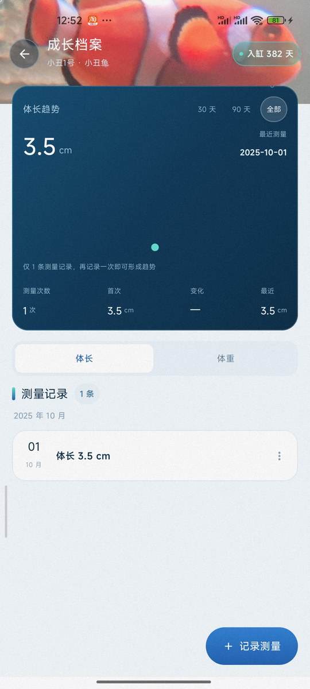
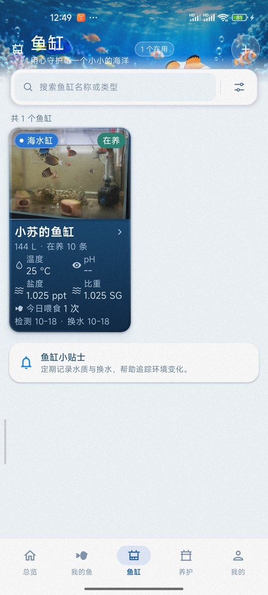
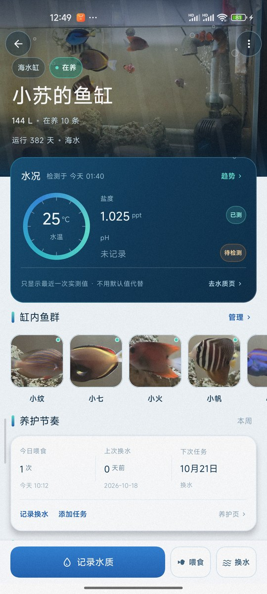
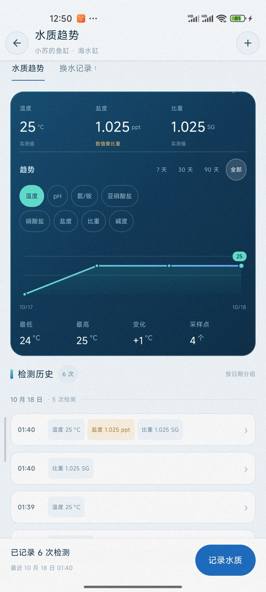
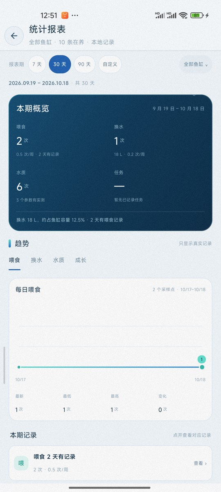
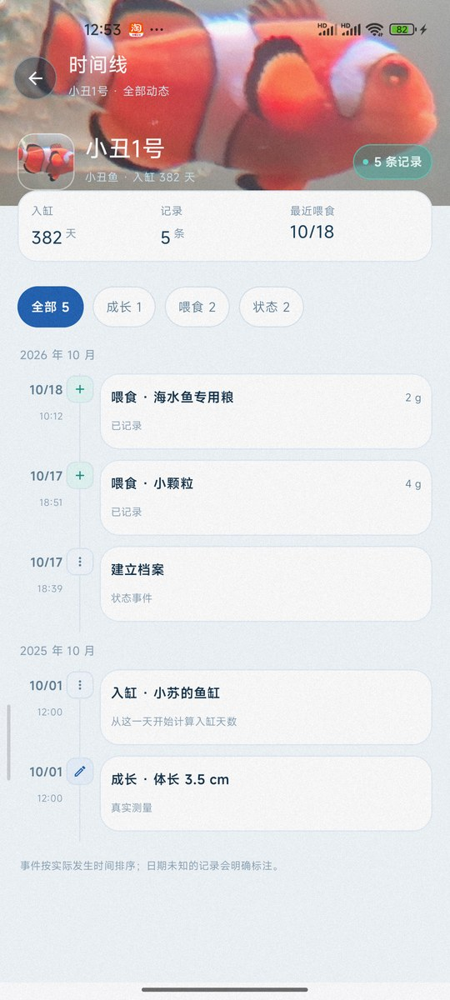

# 观鱼记实机截图

本页汇总真机运行效果图，供 README 与发布说明引用。所有截图截取自真机运行的 Debug 构建，展示的是设备上真实存在的本地记录，不是设计稿、示意图或演示数据。

## 截图信息

| 项目 | 内容 |
| --- | --- |
| 设备 | Xiaomi M2011K2C（Android 14） |
| 分辨率 | 1080 × 2400，420 dpi |
| 构建 | `assembleDebug`，`applicationId = com.guanyji.app`，versionName 1.0 |
| 数据 | 1 个海水缸、10 条在养鱼，真实的水质/喂食/换水/成长记录 |
| 截取时间 | 2026-10-18 |
| 图片处理 | 从 1080 × 2400 压缩并等比缩放到 540 × 1200 JPEG |

## 截图一览

<table>
  <tr>
    <td align="center"> <b>总览</b> 今日养护、快速记录、鱼缸卡片与最近动态</td>
    <td align="center"> <b>我的鱼</b> 搜索、筛选、自定义排序与双列鱼只卡片</td>
    <td align="center"> <b>鱼只详情</b> 头图、今日喂食、水况、成长与记录坞</td>
  </tr>
  <tr>
    <td align="center"> <b>成长档案</b> 体长/体重切换、测量统计与真实数据点</td>
    <td align="center"> <b>鱼缸列表</b> 缸体卡片展示最近水质与今日喂食</td>
    <td align="center"> <b>鱼缸详情</b> 水况、趋势入口、缸内鱼群与底部记录坞</td>
  </tr>
  <tr>
    <td align="center"> <b>水质趋势</b> 参数 chip、7/30/90/全部范围与统计</td>
    <td align="center"> <b>统计报表</b> 本期概览、四类趋势与鱼缸筛选</td>
    <td align="center"> <b>鱼只时间线</b> 按月分组、记录类型筛选与成长事件</td>
  </tr>
</table>

## 页面说明

| 页面 | 展示内容 |
| --- | --- |
| 总览 | 问候与当日摘要、「今天要做的」养护任务、记录喂食/水质入口、鱼缸卡片（最近实测水温/盐度/比重）与最近动态。 |
| 我的鱼 | 10 条在养鱼的双列卡片，含搜索、筛选、自定义排序、今日喂食次数与最近体长。 |
| 鱼只详情 | 头图、今日喂食与撤销、入缸天数/最近体长体重、鱼缸水况、成长趋势、最近动态、底部记录坞。 |
| 成长档案 | 体长趋势、30/90/全部范围、测量次数、首次与变化值；仅使用真实测量点。 |
| 鱼缸列表 | 海水缸卡片，展示容量、在养数量、温度/pH/盐度/比重、今日喂食与检测/换水日期。 |
| 鱼缸详情 | 水况卡（最近实测值 + 趋势入口）、缸内鱼群、养护卡（今日喂食/上次换水/下次任务）、底部记录坞。 |
| 水质趋势 | 水质/换水页签、最近实测主卡、参数 chip、7/30/90/全部范围、折线图与区间统计。 |
| 统计报表 | 7/30/90/自定义报表期、按鱼缸筛选、本期概览（喂食/换水/水质/任务）、四类趋势页签。 |
| 鱼只时间线 | 按月分组的记录流，可筛选全部/成长/喂食/状态，顶部展示入缸天数、记录数与最近喂食。 |

## 相关链接

- [项目 README](../README.md)
- [截图原图目录](screenshots/)
- [第一阶段本地版 App 设计文档](产品设计/第一阶段本地版App设计文档.md)
- [UI 设计总览图](产品设计/UI设计总览图.png)
